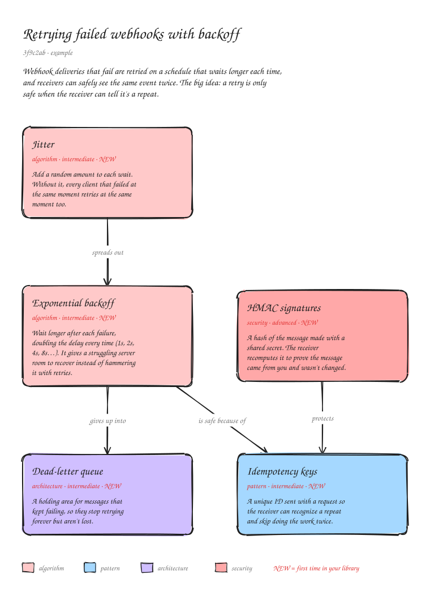

# Concepts

Learn from the code your AI just wrote. **Concepts** is an MCP server, published on npm as [`concepts-mcp`](packages/concepts-mcp). After each commit it draws the change as hand-drawn, Excalidraw-style system-design diagrams, with every concept it relies on marked where it lives, plus a growing library of concept notes.

**Install and setup:** https://ike5.github.io/concepts/



## Repository layout

| Path | What it is |
| --- | --- |
| [`packages/concepts-mcp`](packages/concepts-mcp) | The npm package: MCP server and `init` CLI ([README](packages/concepts-mcp/README.md)) |
| [`docs/`](docs) | The GitHub Pages site with copy-to-clipboard install commands |
| `.github/workflows` | Tests on Linux, macOS and Windows; npm publishing on `v*` tags |

## Develop

```sh
cd packages/concepts-mcp
npm install
npm test
npm run example     # draws examples/commit.json into examples/output/
```

To release, bump `version` in `packages/concepts-mcp/package.json` and `server.json`, then push a `v<version>` tag.

## License and contributing

[PolyForm Noncommercial 1.0.0](LICENSE.md): free for noncommercial use and modification; no selling or commercial use. Pull requests are welcome; see [CONTRIBUTING.md](CONTRIBUTING.md).
