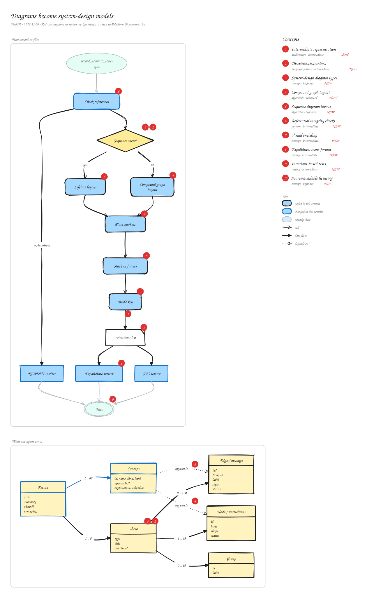

# Diagrams become system-design models

`26af3fb` · 2026-11-06 · Redraw diagrams as system-design models; switch to PolyForm Noncommercial

The agent no longer sends concept boxes with explanations. It sends views (architecture, sequence, flow, state machine, data model) made of shaped parts, boundaries and arrows marked new, changed or existing, plus concepts that point at the parts where they live. The layout turns each view into a list of drawing primitives that both writers consume, and the explanations move out of the picture into the README. The license also changes from MIT to PolyForm Noncommercial.

_Views: From record to files (flow) · What the agent sends (data model). Numbered markers on the diagram match the concepts below. Edit it by opening `concepts.excalidraw` in [excalidraw.com](https://excalidraw.com), Obsidian, or the VS Code Excalidraw extension._

## Concepts

### 1. [Intermediate representation](../../notes/intermediate-representation.md) ✦ new

_architecture · intermediate_

A neutral in-between format that one stage produces and several back ends consume, like a compiler's IR. Each back end only needs to understand the simple format, not the stage before it.

**Why here:** Layout emits a flat list of rectangles, ellipses, lines, arrows and text; the Excalidraw and SVG writers both draw exactly that list, so they can't drift apart.

**On the diagram:** Primitives list, Build key → Primitives list

**Files:** `packages/concepts-mcp/src/scene.js:Canvas`, `packages/concepts-mcp/src/excalidraw.js`, `packages/concepts-mcp/src/svg.js`

### 2. [Discriminated unions](../../notes/discriminated-union.md) ✦ new

_language feature · intermediate_

A type that is one of several shapes, told apart by a tag field. Checking the tag tells you which fields exist, so validation and code can branch safely.

**Why here:** A view's \`type\` decides whether it has nodes and edges or participants and messages; Zod validates each branch with its own schema.

**On the diagram:** View, Sequence view?

**Files:** `packages/concepts-mcp/src/schema.js:viewSchema`

### 3. [System-design diagram types](../../notes/uml-diagrams.md) ✦ new

_concept · beginner_

Standard ways to draw software: architecture (components and connections), sequence (messages over time), flowchart (steps and decisions), state machine (states and transitions) and data model (entities and relationships). Each answers a different question about a system.

**Why here:** Picking the right view for a change is what makes the diagram teach instead of just listing words.

**On the diagram:** Sequence view?, View

### 4. [Compound graph layout](../../notes/compound-graph-layout.md) ✦ new

_algorithm · advanced_

Graph layout where some nodes contain others (clusters), so members are placed together and their boundary can be drawn around them.

**Why here:** Boundaries such as services, layers or trust zones are dagre clusters, so their members are laid out side by side.

**On the diagram:** Compound graph layout

**Files:** `packages/concepts-mcp/src/scene.js:layoutGraph`

### 5. [Sequence diagram layout](../../notes/sequence-layout.md) ✦ new

_algorithm · beginner_

Participants sit in columns with a dashed lifeline below each; time runs downward, one row per message. It needs no graph algorithm, just columns and rows.

**Why here:** Sequence views can't use the graph layout: their order is the point, so they get their own simple grid.

**On the diagram:** Lifeline layout

**Files:** `packages/concepts-mcp/src/scene.js:layoutSequence`

### 6. [Referential integrity checks](../../notes/referential-integrity.md) ✦ new

_pattern · intermediate_

When records point at each other by id, check every reference resolves before accepting the data, the way a database enforces foreign keys.

**Why here:** Edges must name nodes in their view, nodes must name real groups, and every appearsIn must name a real part; ids must be unique across views.

**On the diagram:** Check references, "appearsIn", "appearsIn"

**Files:** `packages/concepts-mcp/src/schema.js:checkRecord`

### 7. [Visual encoding](../../notes/visual-encoding.md) ✦ new

_concept · intermediate_

Map each kind of information to a visual property people read at a glance (shape, color, line weight, dash) and use it consistently, with a key.

**Why here:** Shape says what a part is, fill color its role, outline weight whether this commit added it, dashes whether a message is async, and red numbers mark concepts.

**On the diagram:** Place markers, Build key

**Files:** `packages/concepts-mcp/src/scene.js:look, EDGE`

### 8. [Excalidraw scene format](../../notes/excalidraw-scene-format.md) ✦ new

_library · intermediate_

An .excalidraw file is JSON: a list of elements (shapes, arrows, text, frames) with positions and style. Text can be bound to a container, arrows bound to the shapes they connect, and elements placed inside frames.

**Why here:** Each view becomes a frame; bindings are written both ways so the diagram stays connected when you edit it.

**On the diagram:** Excalidraw writer, Stack in frames

**Files:** `packages/concepts-mcp/src/excalidraw.js`

### 9. [Invariant-based tests](../../notes/invariant-testing.md) ✦ new

_testing · intermediate_

Instead of comparing output to a saved picture, assert properties that must always hold, such as no overlapping boxes, every part inside its frame, every reference bound both ways. They survive harmless layout changes.

**Why here:** Layout output changes whenever spacing is tuned; the tests check what must stay true.

**On the diagram:** Files

**Files:** `packages/concepts-mcp/test/diagram.test.js`

### 10. [Source-available licensing](../../notes/source-available-license.md) ✦ new

_concept · beginner_

Publishing code people can read, use and modify while limiting some uses. PolyForm Noncommercial allows noncommercial use and changes but forbids commercial use; unlike open-source licenses such as MIT, it restricts who may use it.

**Why here:** The project switched from MIT so nobody can sell it.

**Files:** `LICENSE.md`
