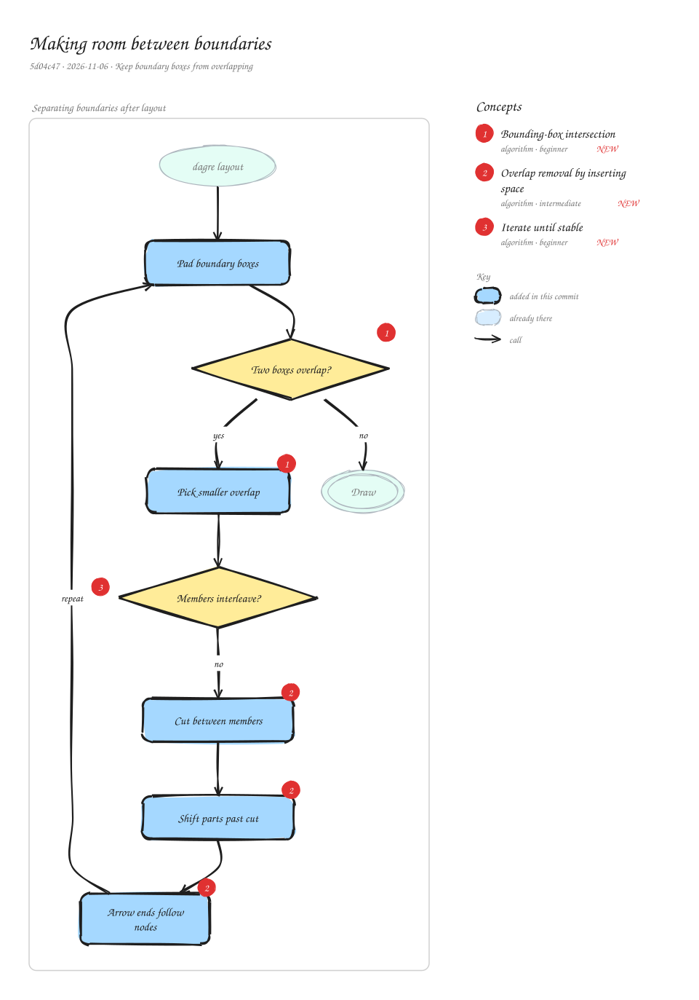

# Making room between boundaries

`5d04c47` · 2026-11-06 · Keep boundary boxes from overlapping

dagre places parts but knows nothing about the title strip and padding drawn around each boundary, so in big views two boundary boxes could overlap. After layout, the scene now checks every pair of boundaries and, where two collide, inserts space between them, moving everything past the gap. It repeats until nothing overlaps.

_Views: Separating boundaries after layout (flow). Numbered markers on the diagram match the concepts below. Edit it by opening `concepts.excalidraw` in [excalidraw.com](https://excalidraw.com), Obsidian, or the VS Code Excalidraw extension._

## Concepts

### 1. [Bounding-box intersection](../../notes/aabb-intersection.md) ✦ new

_algorithm · beginner_

Two axis-aligned rectangles overlap only if they overlap on both the x axis and the y axis. The overlap on each axis is min(right edges) − max(left edges).

**Why here:** It detects colliding boundaries, and the smaller of the two overlaps is the cheapest direction to push them apart.

**On the diagram:** Two boxes overlap?, Pick smaller overlap

**Files:** `packages/concepts-mcp/src/scene.js:separateGroups`

### 2. [Overlap removal by inserting space](../../notes/space-insertion.md) ✦ new

_algorithm · intermediate_

To separate two things without wrecking a layout, draw a line between them and move everything beyond the line by the same amount. Relative order is kept, so the picture only stretches.

**Why here:** Parts, edge routes and labels past the cut all move together; each arrow's ends follow their own node so arrows stay attached.

**On the diagram:** Cut between members, Shift parts past cut, Arrow ends follow nodes

**Files:** `packages/concepts-mcp/src/scene.js:separateGroups`

### 3. [Iterate until stable](../../notes/fixed-point-iteration.md) ✦ new

_algorithm · beginner_

Repeat a fixing step until a pass changes nothing, with a cap on passes so it always ends. Fixing one problem can create another, so a single pass isn't enough.

**Why here:** Opening one gap can make other boxes collide, so the check runs again, at most 40 times.

**On the diagram:** "repeat"

**Files:** `packages/concepts-mcp/src/scene.js:separateGroups`
