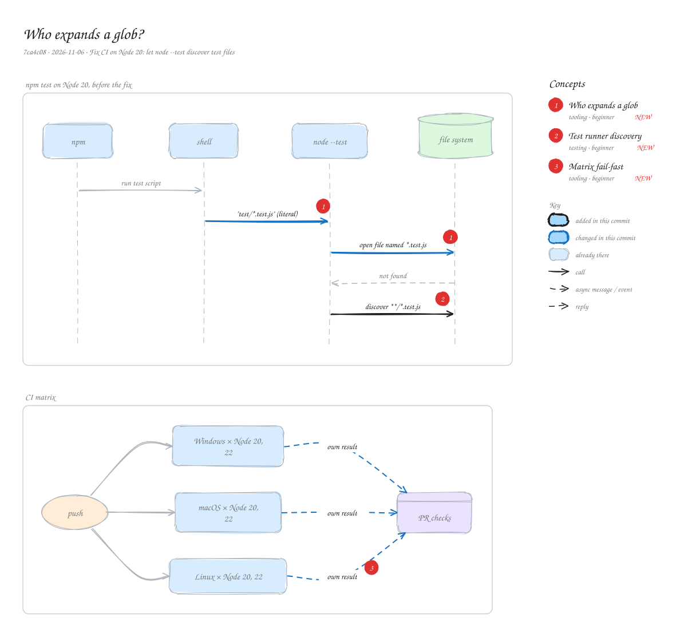

# Who expands a glob?

`7ca4c08` · 2026-11-06 · Fix CI on Node 20: let node --test discover test files

CI failed on Node 20 only. The test script passed a quoted pattern, test/\*.test.js, so the shell left it alone and Node had to expand it itself, which Node 20's test runner can't do. Running plain \`node --test\` lets the runner discover test files on every version. The CI matrix also no longer cancels the other platforms when one fails.

_Views: npm test on Node 20, before the fix (sequence) · CI matrix (architecture). Numbered markers on the diagram match the concepts below. Edit it by opening `concepts.excalidraw` in [excalidraw.com](https://excalidraw.com), Obsidian, or the VS Code Excalidraw extension._

## Concepts

### 1. [Who expands a glob](../../notes/glob-expansion.md) ✦ new

_tooling · beginner_

A pattern like \*.js is usually expanded by the shell before a program starts. Quoting it hands the program the literal text, so the program must expand it itself, and not every program or version can. Windows shells don't expand globs at all.

**Why here:** The quoted pattern reached Node 20's test runner unexpanded, and that runner treats arguments as file paths.

**On the diagram:** ""test/\*.test.js" (literal)", "open file named \*.test.js"

**Files:** `packages/concepts-mcp/package.json:scripts.test`

### 2. [Test runner discovery](../../notes/test-discovery.md) ✦ new

_testing · beginner_

With no file arguments, node --test searches the project for files that look like tests (names ending in .test.js, files under test/ folders) and runs them, skipping node\_modules.

**Why here:** Discovery works the same on Node 20, 22 and later, on every OS, with no pattern to expand.

**On the diagram:** "discover \*\*/\*.test.js"

**Files:** `packages/concepts-mcp/package.json:scripts.test`

### 3. [Matrix fail-fast](../../notes/ci-fail-fast.md) ✦ new

_tooling · beginner_

GitHub Actions cancels the rest of a job matrix as soon as one job fails, unless fail-fast is false. That saves minutes but hides whether the other platforms would have passed.

**Why here:** One Linux failure cancelled the macOS and Windows jobs; now each platform reports its own result.

**On the diagram:** "own result"

**Files:** `.github/workflows/ci.yml`
