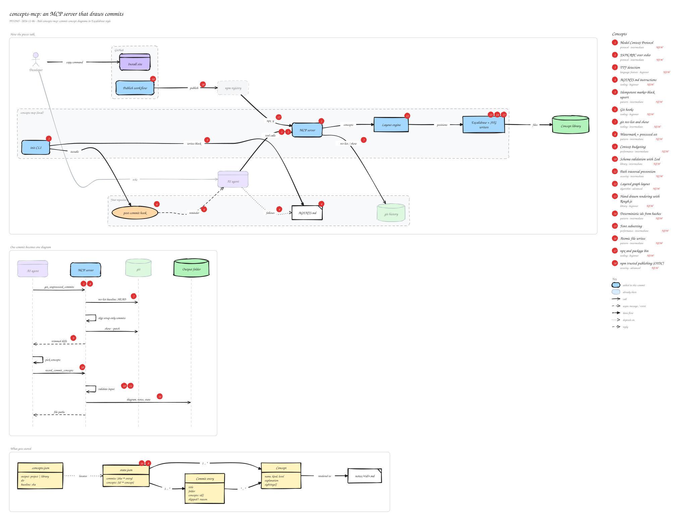

# concepts-mcp: an MCP server that draws commits

`9931945` · 2026-11-06 · Add concepts-mcp: commit concept diagrams in Excalidraw style

The first version of the package. An AI agent, told what to do by AGENTS.md, talks to a local MCP server over stdio. The server reads git to hand the agent new commits, validates what the agent sends back, lays the diagram out as a graph, and writes an .excalidraw file, an SVG and Markdown notes into a project folder or a personal library. An init CLI sets a repository up, a post-commit hook reminds whoever committed, and a GitHub Actions workflow publishes the package to npm without storing a token.

_Views: How the pieces talk (architecture) · One commit becomes one diagram (sequence) · What gets stored (data model). Numbered markers on the diagram match the concepts below. Edit it by opening `concepts.excalidraw` in [excalidraw.com](https://excalidraw.com), Obsidian, or the VS Code Excalidraw extension._

## Concepts

### 1. [Model Context Protocol](../../notes/model-context-protocol.md) ✦ new

_protocol · intermediate_

An open protocol that lets AI apps call tools provided by separate programs. A server describes its tools (name, description, input schema); the client, here the agent, decides when to call them and gets structured results back.

**Why here:** It's how any agent (Claude Code, Cursor, Codex) can use the same diagramming tools without custom integrations.

**On the diagram:** MCP server, "tool calls", "get\_unprocessed\_commits"

**Files:** `packages/concepts-mcp/src/server.js`

### 2. [JSON-RPC over stdio](../../notes/json-rpc-over-stdio.md) ✦ new

_protocol · intermediate_

The client starts the server as a child process and they exchange JSON-RPC messages over its standard input and output. No network port or HTTP server is needed.

**Why here:** The server runs locally next to the repository, so stdio keeps it private and needs no setup beyond npx.

**On the diagram:** "tool calls"

**Files:** `packages/concepts-mcp/src/index.js`

### 3. [TTY detection](../../notes/tty-detection.md) ✦ new

_language feature · beginner_

process.stdin.isTTY tells a program whether a person is typing at a terminal or another program is piping data in.

**Why here:** One binary is both the MCP server (piped stdin) and a CLI; at a terminal it shows help instead of silently waiting.

**On the diagram:** init CLI

**Files:** `packages/concepts-mcp/src/index.js:9-13`

### 4. [AGENTS.md instructions](../../notes/agents-md.md) ✦ new

_tooling · beginner_

A Markdown file at the repository root that coding agents read for project instructions. Claude Code reads CLAUDE.md, which can import it with @AGENTS.md.

**Why here:** The MCP server can't run on its own after a commit; the instruction file is what tells the agent to call it.

**On the diagram:** AGENTS.md, "follows"

**Files:** `packages/concepts-mcp/src/agents.js`

### 5. [Idempotent marker-block upsert](../../notes/idempotent-upsert.md) ✦ new

_pattern · intermediate_

Write generated text between start/end markers, and replace only that block on later runs. Running setup twice gives the same file, and everything outside the markers is left alone.

**Why here:** init edits AGENTS.md and the post-commit hook, files that already belong to the user.

**On the diagram:** "writes block"

**Files:** `packages/concepts-mcp/src/agents.js:upsertBlock, installHook`

### 6. [Git hooks](../../notes/git-hooks.md) ✦ new

_tooling · beginner_

Scripts git runs at points in its workflow. post-commit runs after every commit and can't block it.

**Why here:** The hook prints a reminder that a commit is waiting; its output also reaches an agent that ran git commit.

**On the diagram:** post-commit hook, "reminder"

**Files:** `packages/concepts-mcp/src/agents.js:installHook`

### 7. [git rev-list and show](../../notes/git-plumbing.md) ✦ new

_tooling · intermediate_

Low-level git commands that scripts use: rev-list prints commit ids in a range, and show prints one commit's metadata, file stats or patch in a format you choose.

**Why here:** They list commits since setup and extract each diff without depending on any git library.

**On the diagram:** "rev-list / show", "rev-list baseline..HEAD"

**Files:** `packages/concepts-mcp/src/git.js`

### 8. [Watermark + processed set](../../notes/processed-set.md) ✦ new

_pattern · intermediate_

Remember where you started (a watermark) and which items are done, then compute the work left as 'everything after the watermark minus what's done'. Nothing is missed and nothing is done twice, however irregularly the job runs.

**Why here:** Agents don't run after every commit, so the server works out what's pending from git history instead of trusting the last commit.

**On the diagram:** "get\_unprocessed\_commits", state.json

**Files:** `packages/concepts-mcp/src/core.js:pending`

### 9. [Context budgeting](../../notes/diff-budgeting.md) ✦ new

_performance · intermediate_

Fit what you send a language model into a size limit on purpose: drop low-value content and share the remaining space fairly instead of cutting off at an arbitrary point.

**Why here:** Lockfiles and generated files are removed and each changed file gets a fair share of the diff budget.

**On the diagram:** "trimmed diffs"

**Files:** `packages/concepts-mcp/src/git.js:commitDiff`

### 10. [Schema validation with Zod](../../notes/schema-validation.md) ✦ new

_library · intermediate_

Describe the expected shape of data once and check untrusted input against it at runtime, getting precise errors back. MCP tool schemas are generated from the same definitions.

**Why here:** Everything the agent sends is checked before any file is written, including links and file-name ids.

**On the diagram:** "validate input", "record\_commit\_concepts"

**Files:** `packages/concepts-mcp/src/schema.js`

### 11. [Path traversal prevention](../../notes/path-traversal.md) ✦ new

_security · intermediate_

If user-supplied text becomes part of a file path, values like ../../ can escape the intended folder. Restricting ids to a safe pattern closes that hole.

**Why here:** Concept ids become note file names, so they must match a lowercase slug pattern.

**On the diagram:** "validate input"

**Files:** `packages/concepts-mcp/src/schema.js:slug`

### 12. [Layered graph layout](../../notes/layered-graph-layout.md) ✦ new

_algorithm · advanced_

The Sugiyama method draws directed graphs in layers: assign nodes to ranks, reorder each rank to reduce crossing edges, then set coordinates. dagre implements it.

**Why here:** The agent only says what connects to what; dagre decides where every box goes.

**On the diagram:** Layout engine

**Files:** `packages/concepts-mcp/src/scene.js`

### 13. [Hand-drawn rendering with Rough.js](../../notes/rough-js.md) ✦ new

_library · beginner_

Rough.js turns shapes into slightly wobbly, sketch-like strokes. It is the library behind Excalidraw's look and can output SVG paths without a browser.

**Why here:** The SVG preview matches the Excalidraw file's style and renders on GitHub.

**On the diagram:** Excalidraw + SVG writers

**Files:** `packages/concepts-mcp/src/svg.js`

### 14. [Deterministic ids from hashes](../../notes/deterministic-ids.md) ✦ new

_pattern · intermediate_

Derive ids and random seeds by hashing stable input instead of generating random ones, so the same input always produces byte-identical output.

**Why here:** Re-rendering a commit produces the same .excalidraw file, so git diffs stay clean.

**On the diagram:** Excalidraw + SVG writers

**Files:** `packages/concepts-mcp/src/excalidraw.js:seeded`

### 15. [Font subsetting](../../notes/font-subsetting.md) ✦ new

_performance · intermediate_

Strip a font down to the characters you need so it is small enough to embed. Fonts under the SIL Open Font License must be renamed when modified if they have a reserved name.

**Why here:** A Latin subset of Virgil is embedded in every SVG so the hand-drawn text shows on GitHub, renamed Concepts Hand.

**On the diagram:** Excalidraw + SVG writers

**Files:** `packages/concepts-mcp/fonts/LICENSE-FONT.md`

### 16. [Atomic file writes](../../notes/atomic-write.md) ✦ new

_pattern · intermediate_

Write to a temporary file, then rename it over the real one. A rename is atomic, so a crash leaves either the old file or the new one, never half of each.

**Why here:** state.json is the record of what's been processed; a torn write would lose it.

**On the diagram:** "diagram, notes, state", state.json

**Files:** `packages/concepts-mcp/src/state.js`

### 17. [npx and package bin](../../notes/npm-bin-npx.md) ✦ new

_tooling · beginner_

A package's bin field names the command it provides. npx downloads the package if needed and runs that command, so users never install anything globally.

**Why here:** Every agent's MCP config is just \`npx -y concepts-mcp@latest\`.

**On the diagram:** "npx -y"

**Files:** `packages/concepts-mcp/package.json`

### 18. [npm trusted publishing (OIDC)](../../notes/trusted-publishing.md) ✦ new

_security · advanced_

Instead of storing a long-lived npm token as a secret, the CI job proves its identity with a short-lived OpenID Connect token that npm trusts for this repository and workflow, and npm records provenance.

**Why here:** Releases publish from a tag with no secret to leak.

**On the diagram:** "publish", Publish workflow

**Files:** `.github/workflows/publish-npm.yml`
