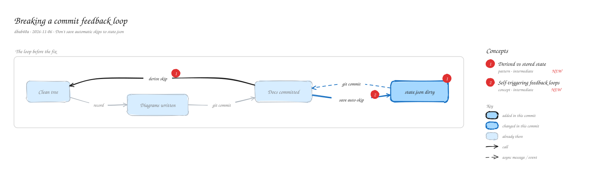

# Breaking a commit feedback loop

`dbab40a` · 2026-11-06 · Don't save automatic skips to state.json

Checking for new commits used to save automatic skips into state.json. In project mode that file is part of the repository, so every diagram commit produced another change to commit. Automatic skips are now derived from each commit's files every time instead of being stored.

_Views: The loop before the fix (state). Numbered markers on the diagram match the concepts below. Edit it by opening `concepts.excalidraw` in [excalidraw.com](https://excalidraw.com), Obsidian, or the VS Code Excalidraw extension._

## Concepts

### 1. [Derived vs stored state](../../notes/derived-state.md) ✦ new

_pattern · intermediate_

If a value can be computed cheaply from data you already have, compute it when needed instead of saving it. Stored copies can go stale and every write has side effects.

**Why here:** Whether a commit only touched setup files is a fact about the commit, so it is now recomputed on every call.

**On the diagram:** "derive skip", state.json dirty

**Files:** `packages/concepts-mcp/src/core.js:pending`

### 2. [Self-triggering feedback loops](../../notes/feedback-loop.md) ✦ new

_concept · intermediate_

A process whose output becomes its own next input never settles. A common case is a tool that writes into the repository it is watching.

**Why here:** Recording a skip changed a tracked file, which needed a commit, which the tool then saw as new.

**On the diagram:** "save auto-skip"

**Files:** `packages/concepts-mcp/test/server.test.js:never dirties the output folder`
